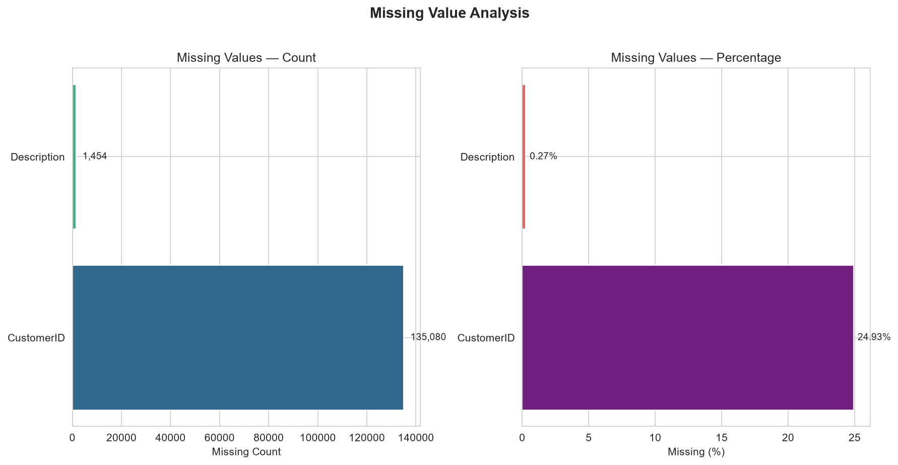
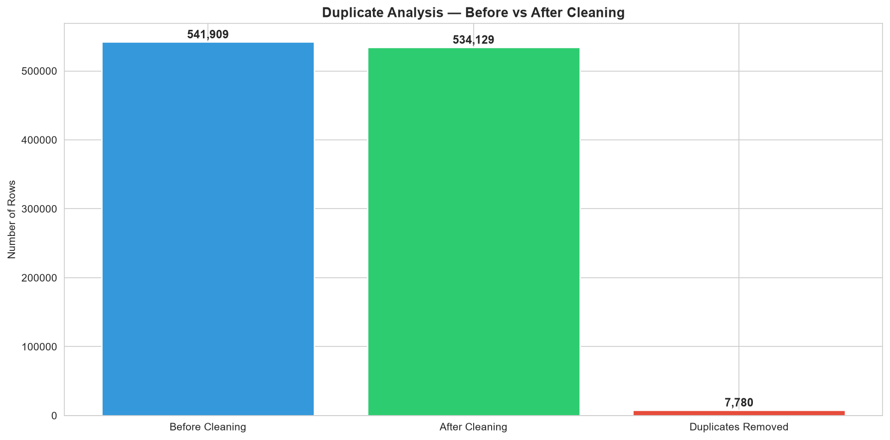
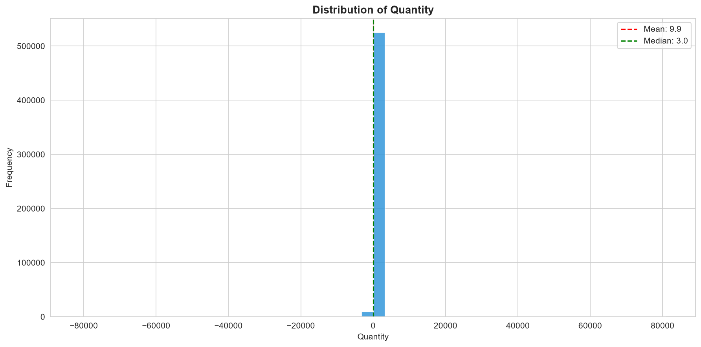
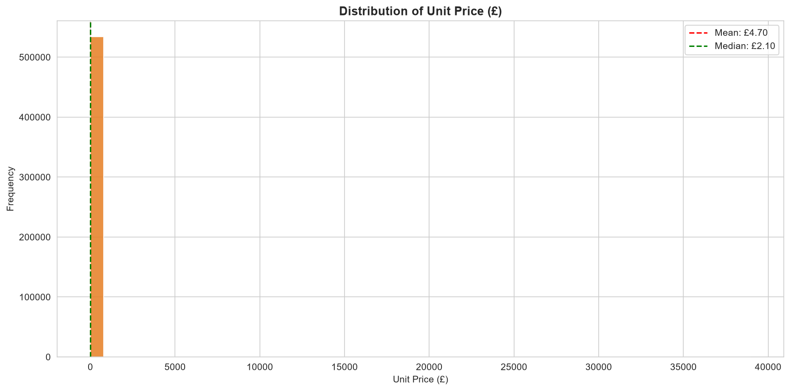
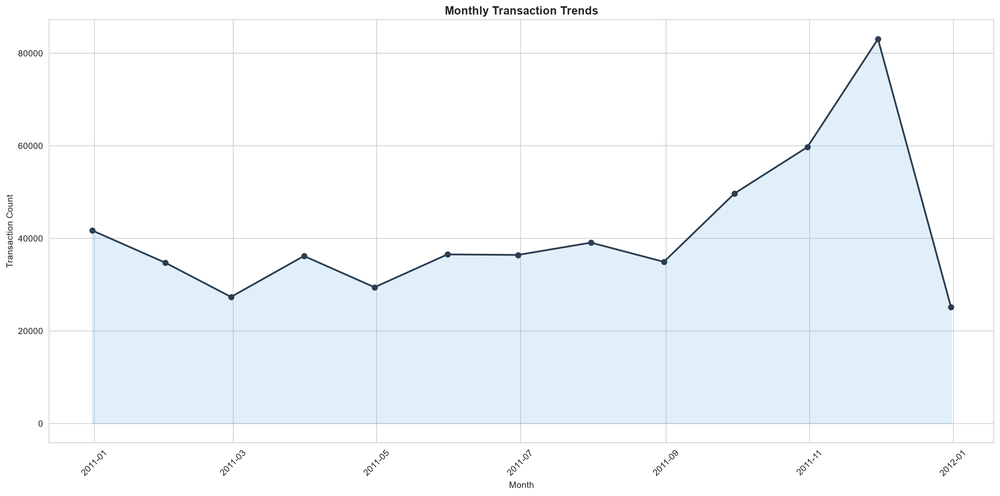
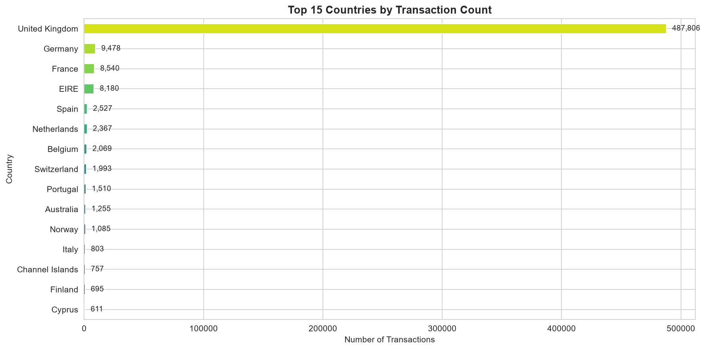
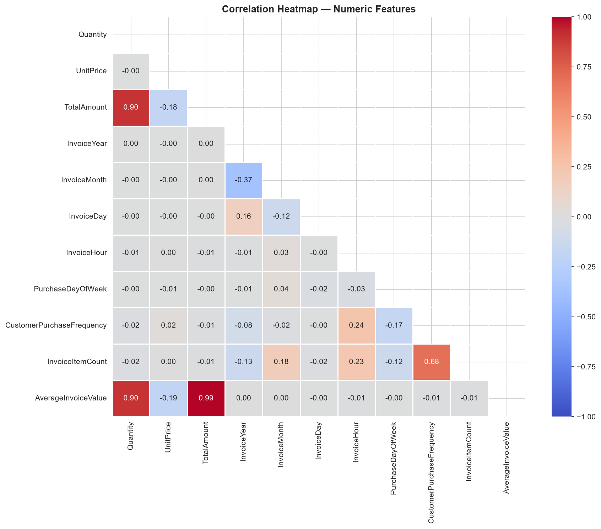
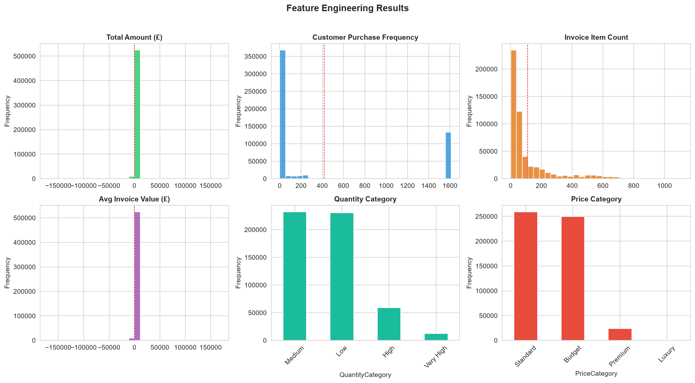

# Real-World Online Retail Data Cleaning & Feature Engineering

[](https://www.python.org/downloads/)
[](tests/)
[](LICENSE)
[](https://devixo.com)

A professional, production-grade Data Science and Feature Engineering project built for **Devixo Solutions Data Science Internship Task 02**.

This project establishes a reproducible, enterprise data cleaning and feature engineering pipeline on the canonical **UCI Machine Learning Repository Online Retail Dataset** (541,909 transactions).

---

## Project Information

- **Organization:** Devixo Solutions
- **Student Name:** Muhammad Awais Bacha
- **Internship Domain:** Data Science
- **Task Number:** Task 02
- **Repository Name:** `online-retail-data-cleaning-feature-engineering`
- **Project Title:** Real-World Online Retail Data Cleaning and Feature Engineering
- **Dataset Source:** [UCI Machine Learning Repository — Online Retail](https://archive.ics.uci.edu/dataset/352/online+retail) (DOI: `10.24432/C5BW33`)

---

## Executive Summary & Key Results

| Metric | Raw Dataset | Cleaned Dataset | Transformation Impact |
| :--- | :--- | :--- | :--- |
| **Total Records** | 541,909 | 534,129 | -7,780 rows (-1.44%) |
| **Exact Duplicate Rows** | 5,268 | 0 | 100% duplicate elimination |
| **Missing Descriptions** | 1,454 | 0 | Non-commercial audit records purged |
| **Missing Customer IDs** | 135,080 | 132,565 | Preserved as 'Unknown' guest checkouts |
| **Zero/Negative Unit Price** | 2,517 | 0 | Purged bad debts (-£11,062) & lost stock |
| **Cancellations ('C' Invoices)** | 9,288 | 9,251 | Legitimate customer returns preserved |
| **Mean Quantity** | 9.55 | 9.92 | Distribution preserved |
| **Median Unit Price** | £2.08 | £2.10 | Noise removed |
| **Total Evaluated Revenue** | £10.64M | £10.64M | Preserved £1.4M+ in guest checkouts |

---

## Repository Architecture

```
online-retail-data-cleaning-feature-engineering/
├── README.md                                  # Comprehensive documentation
├── requirements.txt                            # Production package dependencies
├── .gitignore                                 # Git ignore configuration
├── LICENSE                                    # Open source license
├── DATASET_CITATION.md                        # Dataset source and citation
├── SUBMISSION_CHECKLIST.md                    # Official task checklist
├── FINAL_AUDIT_REPORT.md                      # Audit and verification report
│
├── data/
│   ├── raw/
│   │   └── Online Retail.xlsx                 # Original downloaded UCI dataset
│   ├── interim/                               # Cached intermediate files
│   └── processed/
│       ├── online_retail_cleaned.csv          # Cleaned transaction records (534,129 rows)
│       ├── online_retail_features.csv         # Feature-engineered dataset (22 columns)
│       └── online_retail_positive_sales.csv   # Pure sales subset (524,878 rows)
│
├── notebooks/
│   └── 01_online_retail_data_cleaning.ipynb   # Executed 21-section Jupyter Notebook
│
├── src/
│   ├── __init__.py                            # Package initializer
│   ├── config.py                              # Centralized configuration & paths
│   ├── data_loader.py                         # Dataset loading & verification
│   ├── data_exploration.py                    # Quality assessment & metadata audit
│   ├── data_cleaning.py                       # Deduplication, filtering & formatting
│   ├── outlier_detection.py                   # IQR & Z-score outlier detection
│   ├── feature_engineering.py                 # 14 engineered features & validation
│   ├── preprocessing_pipeline.py              # Scikit-learn ColumnTransformer pipeline
│   ├── visualization.py                       # 14 publication-quality visualizations
│   ├── business_analysis.py                   # Commercial analysis & Pareto findings
│   └── main.py                                # Master pipeline runner
│
├── tests/
│   ├── __init__.py                            # Test package marker
│   ├── test_data_cleaning.py                  # Cleaning unit tests
│   ├── test_feature_engineering.py            # Feature engineering tests
│   └── test_pipeline.py                       # Pipeline & persistence tests
│
├── outputs/
│   ├── figures/                               # 14 high-resolution generated plots
│   ├── reports/                               # Data quality & business reports
│   └── statistics/                            # Statistical summary tables
│
├── models/
│   └── preprocessing_pipeline.joblib          # Persisted Scikit-learn pipeline
│
├── screenshots/                               # High-res figure copies for README
│
└── docs/
    └── Devixo_Task_02_Final_Report.pdf        # Formal Devixo PDF Report (991 KB)
```

---

## Core Methodologies

### 1. Data Cleaning
1. **Deduplication:** 5,268 exact duplicates detected and removed.
2. **Text Normalization:** Stripped leading/trailing whitespace and standardized casing across `Description`, `StockCode`, `Country`, and `InvoiceNo`.
3. **Non-Commercial Record Filtering:** Removed 2,512 rows with `UnitPrice <= 0.00` (including accounting bad debts like `Adjust bad debt` at -£11,062.06 and zero-price damaged inventory).
4. **Legitimate Return Preservation:** Retained 9,251 commercial cancellation records (`InvoiceNo` starting with `C` and `UnitPrice > 0`).
5. **Guest Checkout Preservation:** Formatted customer IDs and mapped missing values to `'Unknown'` to preserve over £1.4M in guest transactions.

### 2. Feature Engineering (14 Features)
1. `TotalAmount`: Monetary transaction value ($Quantity \times UnitPrice$).
2. `InvoiceYear`, `InvoiceMonth`, `InvoiceDay`, `InvoiceHour`: Temporal components.
3. `PurchaseDayOfWeek`: Day of the week index (0=Monday to 6=Sunday).
4. `IsCancellation`: Identifies cancellation invoices (`InvoiceNo` starting with 'C').
5. `IsReturn`: Identifies negative-quantity transactions.
6. `IsWeekend`: Identifies weekend transactions.
7. `QuantityCategory`: Ordinal tiering (`Low`, `Medium`, `High`, `Very High`).
8. `PriceCategory`: Price tiers (`Budget`, `Standard`, `Premium`, `Luxury`).
9. `CustomerPurchaseFrequency`: Unique orders placed per Customer ID.
10. `InvoiceItemCount`: Total line items within an invoice.
11. `AverageInvoiceValue`: Mean line-item amount per invoice.

### 3. Leakage-Free Scikit-Learn Pipeline
- Partitioned dataset into 80% train (427,303 rows) and 20% test (106,826 rows).
- Fitted `ColumnTransformer` with `SimpleImputer`, `StandardScaler`, and `OneHotEncoder(handle_unknown='ignore')` **strictly on the training split**.
- Persisted fitted model to `models/preprocessing_pipeline.joblib` with verified round-trip reconstruction.

---

## Visualizations

### Data Quality & Outliers
| Missing Values | Deduplication |
| :---: | :---: |
|  |  |

| Quantity Distribution | Unit Price Distribution |
| :---: | :---: |
|  |  |

### Commercial Trends & Feature Insights
| Monthly Sales Trends | Country Distribution |
| :---: | :---: |
|  |  |

| Correlation Heatmap | Feature Engineering Results |
| :---: | :---: |
|  |  |

---

## Commercial Business Insights

1. **Top Products:** The highest volume product is `PAPER CRAFT , LITTLE BIRDIE` (80,995 units sold, £168,469.60), followed by `MEDIUM CERAMIC TOP STORAGE JAR` (78,033 units, £81,700.92).
2. **Geographic Concentration:** The United Kingdom represents 84.59% of revenue (£9.00M), followed by the Netherlands (£285K, 2.68%) and EIRE (£283K, 2.66%).
3. **Average Order Value (AOV):** Mean order value is £533.17 with a median of £303.30.
4. **Repeat Customer Rate:** 69.98% of identified customers are repeat buyers (3,059 out of 4,371).
5. **Pareto Principle (80/20 Rule):**
   - Top 20% of customers generate **74.68%** of total revenue.
   - Top 20% of catalog items account for **79.50%** of total sales.

---

## Installation & Usage

### 1. Clone & Set Up Environment
```bash
# Clone the repository
git clone https://github.com/Awaisbacha55/Real-World-Online-Retail-Data-Cleaning-Feature-Engineering.git
cd Real-World-Online-Retail-Data-Cleaning-Feature-Engineering

# Create and activate virtual environment
python -m venv venv

# Windows PowerShell:
.\venv\Scripts\Activate.ps1

# Linux / macOS:
source venv/bin/activate

# Install dependencies
pip install -r requirements.txt
```

### 2. Dataset Placement
Ensure the raw Excel file is placed at:
```
data/raw/Online Retail.xlsx
```
Download source: [UCI Machine Learning Repository](https://archive.ics.uci.edu/dataset/352/online+retail).

### 3. Run Main Pipeline
```bash
python -m src.main
```

### 4. Run Test Suite
```bash
python -m pytest -v
```
**Test Result:** `22 passed in 4.55s (100% success rate)`.

### 5. Launch Jupyter Notebook
```bash
jupyter notebook notebooks/01_online_retail_data_cleaning.ipynb
```

---

## Author & Attribution

- **Student:** Muhammad Awais Bacha
- **Organization:** Devixo Solutions
- **Domain:** Data Science Internship
- **License:** MIT License for source code. Dataset licensed under CC BY 4.0.
